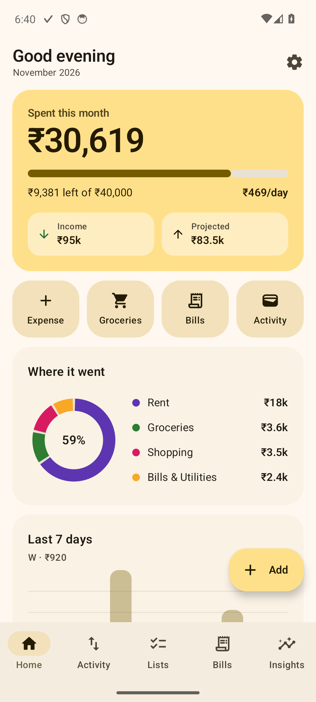
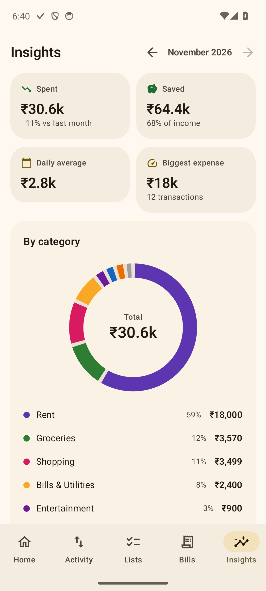
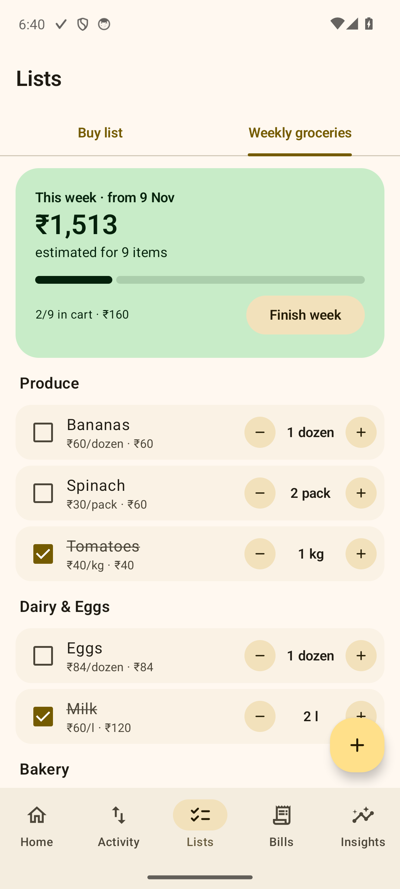
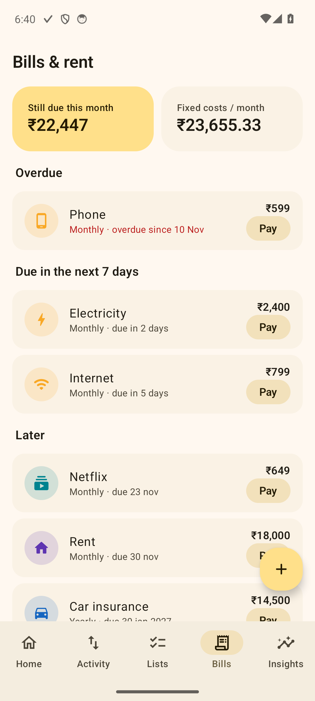
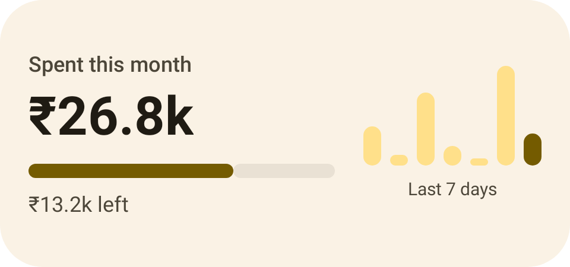
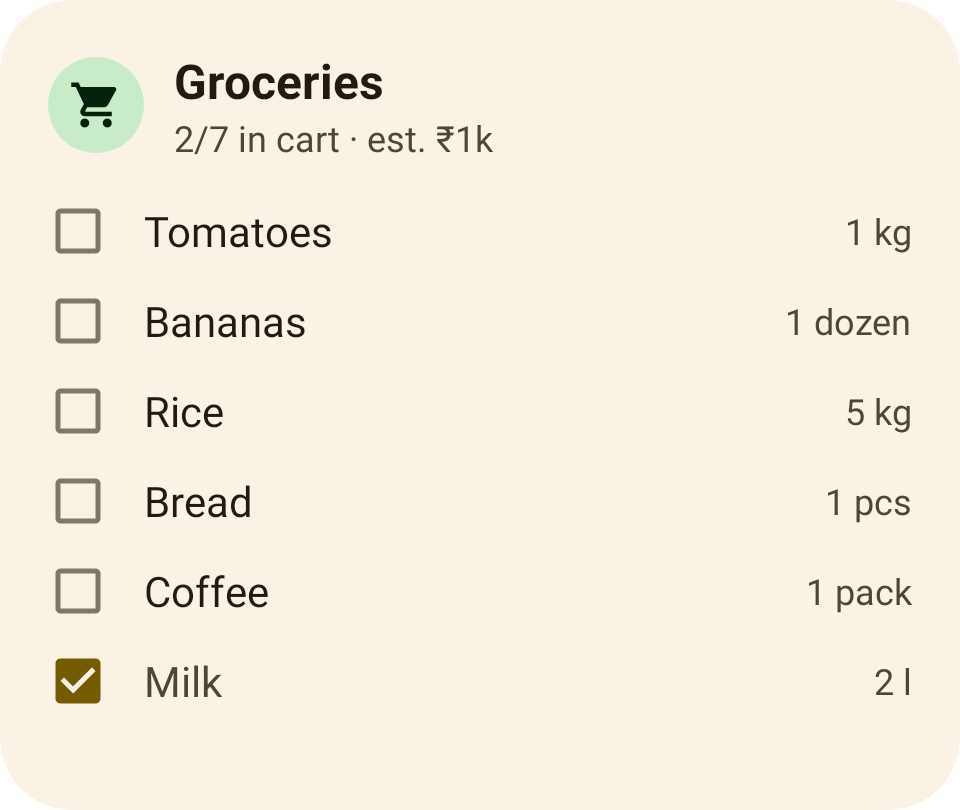
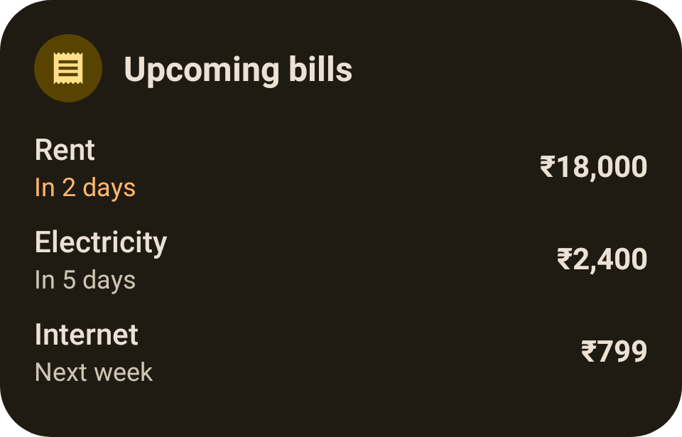

# Midas

**Your money, all in one place.** Midas is an Android app for tracking spending, planning purchases, running a weekly grocery list, keeping on top of rent and bills, and seeing where your money goes. It uses Material 3 throughout and has home screen widgets.

Everything stays on your phone: there are no accounts, no cloud and no tracking.

<p>
  
  
  
  
</p>

## Features

| | |
|---|---|
| **Dashboard** | What you've spent this month against your budget, how much you can spend per day, projected month-end spend, a category donut, the last 7 days, upcoming bills and recent activity. |
| **Transactions** | Expenses and income with a category, payment method, date and note. Search, filter, swipe to delete (with undo), and browse month by month. |
| **Buy list** | Things you plan to buy, with an estimated price, priority and target date. Tick one off and it's recorded as an expense automatically. |
| **Weekly groceries** | A reusable list with quantities and units (kg, l, pcs and more) and price per unit, so you know what the shop will cost before you go. "Finish week" logs what you actually spent and keeps a weekly history. |
| **Bills & rent** | Weekly, monthly or yearly bills with reminders before they're due. Mark one paid to record the payment and move it to the next due date. A bill due on the 31st stays on the 31st, even after a short month. |
| **Budgets** | An overall monthly budget plus a budget for each category, with warning colors at 80% and when you go over. |
| **Insights** | Spending against last month, savings rate, daily average, a category breakdown, daily bars against your daily budget, a spending-pace line, a 6-month trend, your grocery cost trend and your biggest expenses. |
| **Settings** | 10 currencies (Indian lakh grouping for ₹), light, dark or system theme, optional Material You wallpaper colors, CSV export and import, and category editing. |

### Home screen widgets

| Spending | Grocery checklist | Upcoming bills (dark) |
|---|---|---|
|  |  |  |

There's also a 1×1 **Quick add** widget. Grocery items can be ticked off right on the home screen. The widget picker shows a live preview of the real widget on Android 15+, a layout preview on Android 12–14, and rendered images (light and dark) on older versions. Long-press the app icon for shortcuts to add an expense, open groceries or open bills.

## Install

Download the latest `Midas-vX.Y.Z.apk` from **[Releases](../../releases)**, open it on your phone and allow installing from your browser or file manager. It needs Android 8.0 or newer. Updates install over the top and keep your data.

## Tech stack

- **Kotlin**, **Jetpack Compose**, **Material 3** (Material You dynamic color optional)
- **Room** (SQLite) for data, **DataStore** for settings
- **Jetpack Glance** for widgets, with generated previews
- **WorkManager** for bill reminders
- Charts drawn with the Compose Canvas: donut, bar and line, all animated and themed
- Type-safe Navigation Compose, MVVM, and a small hand-written dependency container
- All money is stored as whole minor units (`Long` paise or cents), so totals never pick up floating-point errors

## Development

```bash
./gradlew :app:testDebugUnitTest   # 79 unit, Robolectric and Compose UI tests
./gradlew :app:lintDebug
./gradlew :app:assembleDebug
```

- The tests cover:
  - money parsing and formatting
  - recurrence edge cases (31st of the month, leap years)
  - budgets, stats and CSV round trips
  - Room repositories (buy-list purchases, finishing a grocery week, paying a bill)
  - screen state, Compose screens
  - widget data
- Widget preview images are rendered from the preview layouts by a Robolectric test:
  `./gradlew :app:testDebugUnitTest --tests '*WidgetPreviewTest*' -Dmidas.renderPreviews=true`
- Demo data for debug builds: `adb shell am start -n dev.suks.midas/.MainActivity --ez seed_demo true`

### Releasing

Push a tag and GitHub Actions runs the tests, builds a signed APK and publishes the release:

```bash
git tag v1.0.0 && git push origin v1.0.0
```

The signing key comes from these repository secrets: `MIDAS_KEYSTORE_BASE64`, `MIDAS_KEYSTORE_PASSWORD`, `MIDAS_KEY_ALIAS` and `MIDAS_KEY_PASSWORD`. For local release builds, put the same values in a git-ignored `keystore.properties` file (`storeFile`, `storePassword`, `keyAlias`, `keyPassword`).
